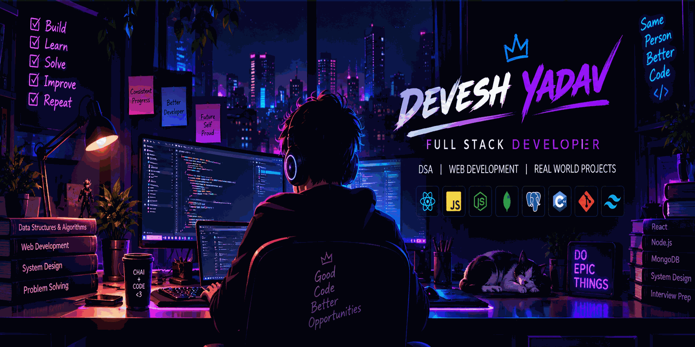

### Full Stack Developer · C++ · Data Structures & Algorithms

*Building useful products, solving problems, and getting better with every commit.*

---

## 👨‍💻 About Me

- 🎓 B.Tech Computer Science & Engineering student, graduating in **2028**
- 💻 Focused on **Full Stack Web Development** and **Data Structures & Algorithms**
- 🧩 Enjoy building practical applications with JavaScript and C++
- 🌱 Currently strengthening problem-solving skills and backend development
- 🎯 Interested in clean code, useful products, and continuous learning

## ⚡ Tech Stack

**Languages**

**Frontend & Backend**

**Databases & Tools**

## 🚀 Featured Projects

### 🌱 [EcoBot](https://github.com/DeveshYadav9107/EcoBot)
An eco-friendly product suggestion chatbot designed to help users explore greener alternatives.

**Focus:** AI-powered suggestions · Web development · Sustainability

### 📄 Invoice Verification System
A web application concept for extracting invoice data, validating it against purchase/order records, and supporting a structured verification workflow.

**Focus:** Full-stack development · Data extraction · Verification workflows

### 🚚 OneKeep — Industrial Service & Logistics Platform
A platform concept for connecting businesses with service providers and drivers, with shipment workflows and real-time tracking features.

**Focus:** React · Node.js · Express · Database design · Real-time features

> Add repository links to the last two projects once their public GitHub repositories are ready.

## 📊 GitHub Overview

 

> Stats cards are served by external services. If a card is temporarily unavailable, your profile README will still work; try again later.

## 🤝 Let's Connect

- GitHub: [@DeveshYadav9107](https://github.com/DeveshYadav9107)
- Portfolio: Coming soon

### `BUILD · LEARN · SOLVE · REPEAT`

*Thanks for stopping by — feel free to explore my repositories!*

